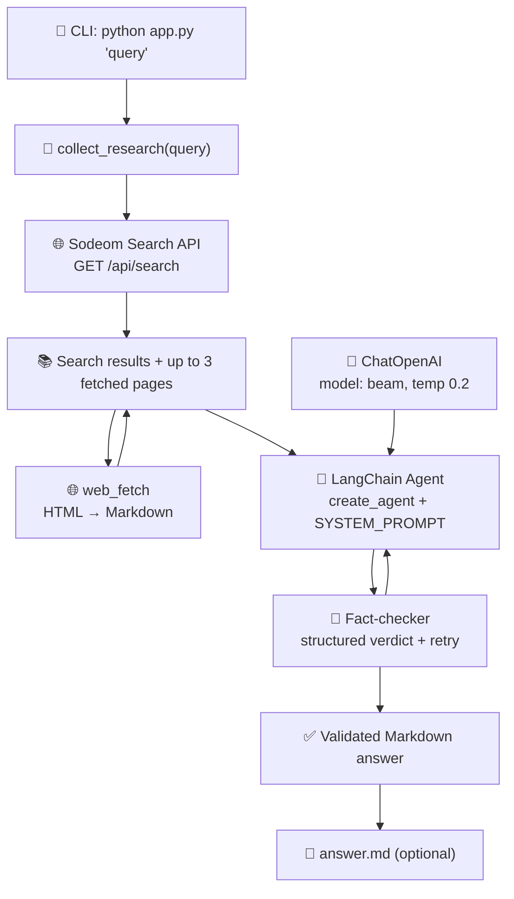
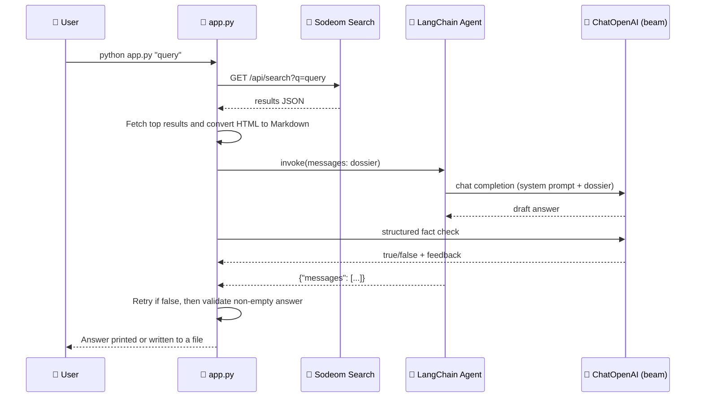
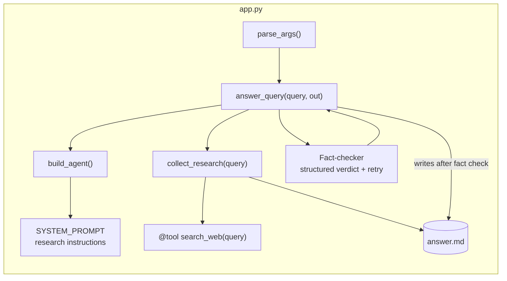

# 🌐 LangChain General Web Research Agent

> Ask it anything. It searches the web, fetches pages as clean Markdown, fact-checks the draft, and returns a cited answer.

[](https://python.langchain.com/)
[](https://www.python.org/)
[](https://platform.openai.com/)
[](LICENSE)

---

## ✨ What it does

1. **Searches** — queries any topic against the Sodeom search API.
2. **Fetches** — downloads the most relevant pages, removes scripts/styles, and converts HTML to Markdown.
3. **Answers** — drafts a sourced response, sends it to a structured fact-checking agent, and retries with corrections before writing the file.

### 🎬 Demo

```bash
$ python app.py "What are the latest developments in AI agents?"
Answer written to answers/ai-agents.md
```

The result is a sourced Markdown answer that is fact-checked before it is saved.

---

## 🗺️ Architecture



---

## 🔄 Pipeline flow



---

## 📦 Installation

### Prerequisites

- **Python 3.10+**
- Access to the Sodeom API (search + OpenAI-compatible chat endpoint)

### Steps

```bash
# 1. Clone the repo
git clone https://github.com/<your-username>/blogs-langchain.git
cd blogs-langchain

# 2. Create and activate a virtual environment
python -m venv .venv
source .venv/bin/activate        # Windows: .venv\Scripts\activate

# 3. Install dependencies
pip install -r requirements.txt
```

**Dependencies** ([`requirements.txt`](./requirements.txt)):

| Package | Version | Purpose |
| --- | --- | --- |
| [`langchain`](https://pypi.org/project/langchain/) | `>=1.0.0` | Agent orchestration (`create_agent`, `@tool`) |
| [`langchain-openai`](https://pypi.org/project/langchain-openai/) | `>=1.0.0` | `ChatOpenAI` client for any OpenAI-compatible endpoint |
| [`markdownify`](https://pypi.org/project/markdownify/) | `>=0.14.0` | Converts fetched HTML into Markdown |

---

## 🚀 Usage

```bash
python app.py "Your question here"
```

### Options

| Flag | Default | Description |
| --- | --- | --- |
| `query` (positional) | — | The question or topic to research |
| `-o`, `--output` | stdout | Optional path for the generated Markdown answer |
| `--max-attempts` | `3` | Maximum draft/fact-check retries |

### Examples

```bash
# Default output location
python app.py "What is retrieval augmented generation?"

# Custom output path
python app.py "Compare vector databases" -o answers/vector-databases.md

# See all flags
python app.py --help
```

---

## ⚙️ Configuration

All settings are environment variables with sensible defaults:

| Variable | Default | Purpose |
| --- | --- | --- |
| `SODEOM_BASE_URL` | `https://sodeom.com` | Base URL for the web search API |
| `SODEOM_OPENAI_BASE_URL` | `https://sodeom.com/v1` | OpenAI-compatible chat base URL |
| `SODEOM_API_KEY` | `sodeom` | API key sent to the chat endpoint |
| `SODEOM_MODEL` | `beam` | Model name used by `ChatOpenAI` |

```bash
# Override example
export SODEOM_MODEL="beam"
export SODEOM_API_KEY="your-key-here"
python app.py "retrieval augmented generation"
```

---

## 🧩 Code map



| Function / Symbol | Role |
| --- | --- |
| `SYSTEM_PROMPT` | Instructs the agent to answer from fetched evidence and include consulted sources |
| `search_web` | `@tool` that queries `GET /api/search` for any topic |
| `web_fetch` | `@tool` that downloads a webpage, removes unsafe/noisy HTML, and converts it to Markdown |
| `build_agent` | Constructs `ChatOpenAI` (temp `0.2`, `max_tokens=3000`) and wraps it with `create_agent` |
| `collect_research` | Searches and fetches up to three relevant pages |
| `answer_query` | Orchestrates research → draft → fact-check/retry → validation → file write |
| `FactCheck` | Structured `true`/`false` verdict and correction feedback |
| `parse_args` | argparse CLI (`query`, `-o/--output`, `--max-attempts`) |

---

## 📄 Output format

The generated answer is Markdown and includes a Sources section:

```markdown
Answer based on the fetched evidence...

## Sources
- https://...
- https://...
```

The output is generated for each query and can be saved with `-o`.

---

## ⚠️ Notes & limitations

- The search tool is called directly in `collect_research()` (not through agent tool-calling), so the agent itself runs with `tools=[]` — research happens **before** the agent, writing happens **inside** it.
- Search results and fetched pages are truncated to keep the prompt bounded.
- The fact checker retries drafts up to `--max-attempts`; unresolved drafts receive a warning rather than being silently presented as verified.
- The agent is prompted not to fabricate quotes, benchmarks, or URLs; still, review sources before publishing.
- Output quality depends on the model served at `SODEOM_OPENAI_BASE_URL`.

---

## 🗂️ Repository layout

```
blogs-langchain/
├── app.py            # CLI entry point: research + write pipeline
├── app.py            # Search, fetch, draft, fact-check, and output pipeline
├── requirements.txt  # langchain, langchain-openai
├── README.md         # This file
└── .venv/            # Virtual environment (local)
```

---

## 📄 License

MIT — do whatever, just keep the attribution.
